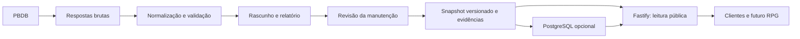

# Arquitetura

## Fluxo de dados

## Módulos

- `src/domain/catalog.ts`: contratos validados, identidade dos táxons e integridade das relações.
- `src/import/pbdb.ts`: consulta específica da fonte, normalização, quarentena e critérios de resolução histórica.
- `src/catalog-store.ts`: obtenção do snapshot validado de arquivo ou PostgreSQL.
- `src/app.ts`: contrato HTTP, paginação, resolução, cache, limites e OpenAPI.
- `src/server.ts`: configuração e ciclo de vida do processo.
- `scripts/`: tarefas de manutenção, independentes da interface HTTP.

## Persistência inicial

O catálogo é pequeno o suficiente para ser carregado em memória no início do processo e consultado sem rede externa. Essa decisão permite usar e hospedar a API antes de contratar infraestrutura de banco.

Quando `DATABASE_URL` está definido, PostgreSQL conserva documentos JSONB imutáveis, endereçados por hash, e um ponteiro para o catálogo atual. A carga troca o ponteiro em transação. O processo HTTP continua lendo uma cópia em memória; mudanças exigem reinicialização. O armazenamento inicial ainda não é um esquema relacional completo de ocorrências e afirmações científicas. Essa evolução será feita quando esses recursos entrarem no produto, preservando os IDs e o contrato público.

IDs `pbdb-N` são identidades externas namespaced. Não reutilizar IDs removidos. Adicionar outras fontes poderá exigir uma identidade interna e uma tabela de correspondência explícita. Slugs não são chaves únicas: a fonte já contém homônimos.

## HTTP

Recursos sob `/api/v1`. Leitura sem autenticação, CORS configurável, 120 requisições por minuto por IP e instância, cache público por 300 segundos e ETags por snapshot e URL. A limitação atual é local ao processo; múltiplas instâncias precisam de controle compartilhado ou no proxy. Não ativar confiança irrestrita em cabeçalhos de proxy; configurar o proxy conhecido quando necessário.

Listas usam paginação por offset com ordenação por slug. Um novo snapshot pode alterar a posição de itens; clientes que exportem dados devem usar uma versão consistente. IDs são os links canônicos; nomes são uma conveniência, com conflitos expostos como HTTP 409. Aliases resolvem na mesma resposta HTTP 200, com `resolution` e `Content-Location`, evitando redirecionamentos opacos em clientes JSON.

## Relação com a PokéAPI

A inspiração está na ergonomia: leitura pública, recursos por nome/ID, paginação previsível, recursos relacionados e documentação navegável. O catálogo científico acrescenta procedência, incerteza, homônimos, sinônimos e recorte taxonômico datado. Não inclui estatísticas de jogo nem conteúdo Pokémon. Referência: [documentação oficial](https://pokeapi.co/docs/v2).
